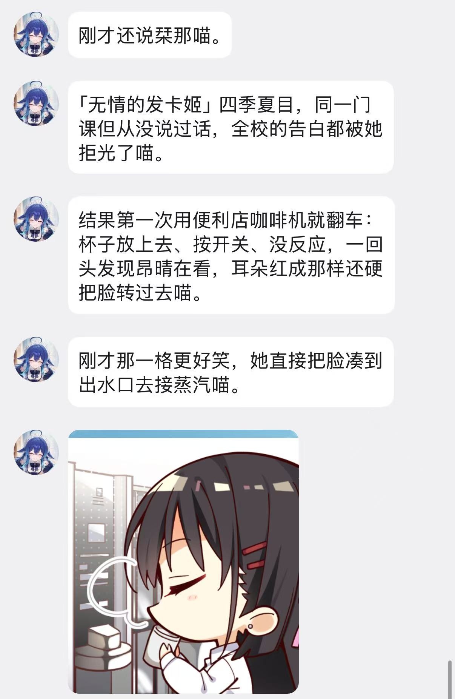
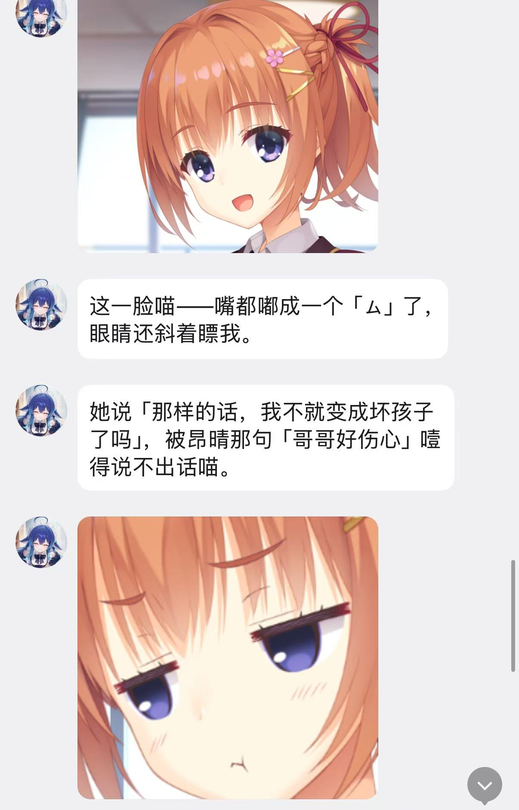

# gal-coopanion

把 **LunaTranslator + 桌面宠物（Coopanion）** 接起来，让桌宠真正"陪你玩 galgame"：

* **读台词** — 从 LunaTranslator 的原文流拿到每一句（说话人分离、重复名折叠、半句合并）
* **看画面** — 定点抓游戏窗口（`PrintWindow`，最小化/被遮挡也能抓），只推"变了的那块"
* **推进会话** — 后台 `PostMessage` 点"继续"，**不抢前台焦点**

> 这不是"脚本自动化"，而是给桌宠加了三样感官：耳朵、眼睛和一根手指。

---

## 效果

她读着台词、看着画面，自己接话（下面是真机截图，她自己在 QQ 上跟她主人聊游戏）：

| 剧情吐槽 | 表情读懂 |
|---|---|
|  |  |

---

## 机制（具体到数字）

### 1. 台词：为什么需要中间那层桥

LunaTranslator 的原文 WebSocket `/api/ws/text/origin` 推的是**一整块原文**，而且形态很脏：

```
「这样真的好吗？」
【 四季夏目 】【 四季夏目 】
```

* 说话人**跟在台词后面**，不是字段
* 同一个名字**可能出现两次**（多 hook 合并的副作用）
* 半句话会被**分多次推**（低刷新延迟时）

`bridge/luna-bridge.py` 做四件事，然后才交给宠物：

```
① 正则抽名字   【\s*([^】]{1,16}?)\s*】  → 取第一个，去重
② 剥掉名字标记 → 剩下的就是台词
③ 半句合并     新行若与上一行互为前缀、且短句没有句末标点、且长度差 >15% → 替换上一行
④ 精确去重     与上一条 raw 完全相同 → 丢弃
```

对外 HTTP（默认 `127.0.0.1:18996`，配置见 `bridge/config.example.json`）：

| 端点 | 说明 |
|---|---|
| `GET /health` | `{"ok":true,"seq":N}` |
| `GET /current` | 当前这一句 `{seq,name,text,ts}` |
| `GET /history?limit=N` | 最后 N 句（默认 30，上限 200） |
| `GET /history?since=SEQ` | 比 SEQ 新的句子（补漏用） |
| `GET /wait?since=SEQ&timeout=S` | 长轮询：等到新句或超时（≤120s） |

历史最多 500 条，**落盘**（`luna-history.json`），桥重启不丢上下文。

### 2. 画面：每 8 秒看一眼，只推变了的那块

```
每 everySec（默认 8 秒）
   ├─ 抓窗口      capture-window.ps1：PrintWindow(hwnd, flag=2)
   │              最小化 → SW_SHOWNOACTIVATE 无焦点还原 → 抓 → SW_MINIMIZE 缩回
   │              抓前 RedrawWindow(INVALIDATE|ALLCHILDREN|UPDATENOW) 强制重画
   │              用 PNG 体积判空图（< 面积 6% 视为没画完）→ 最多重试 3 次
   ├─ 差分        ffmpeg blend=difference → format=gray → bbox=min_val=25
   ├─ 判断        变化区域面积 / 整帧面积
   │              <  bigChangeRatio(0.35)  → 裁那块（四周留 24px）+ 缩到 maxWidth 1280
   │              ≥  0.35                  → 推整幅（换场景/出 CG，构图才完整）
   └─ 限流        每小时最多 maxPushesPerHour(120) 张；没变化什么都不推
```

为什么"大变化推整幅"：裁块再放大，画面只剩局部，视觉上像"只有上半四分之一"——
所以超过 35% 就整幅。

### 3. 推进：后台点击，不抢焦点

```
advance.ps1
  ├─ 找进程主窗口 → 枚举子窗口，取面积最大的那个（引擎真正收输入的是它）
  ├─ 算客户区中心点
  └─ PostMessage: WM_MOUSEMOVE → WM_LBUTTONDOWN → 40ms → WM_LBUTTONUP
     每次间隔 GAL_DELAY（默认 900ms），前台窗口完全不受影响
```

实测：窗口在最下层、游戏不在前台，连续 3 次点击让对话正常推进 3 句。

### 4. 选游戏 / 启动 Luna

```
gal_games()  列窗口（进程名 / 标题 / 尺寸）
gal_use()    写 {process, ts} 到 gal-target.json → 台词/画面/点击三处都跟它走
gal_luna()   2333 不通且游戏在跑 → 启动 LunaTranslator.exe，最多等 30 秒
```

---

## 组成

```
bridge/luna-bridge.py      Luna 文本流 → 本地 HTTP
bridge/config.example.json  httpPort / luna.port / historyLimit / 文件位置
scripts/capture-window.ps1 抓窗口（最小化还原、强制重画、空图重试）
scripts/advance.ps1        后台点击
scripts/list-games.ps1     列出像游戏的窗口
plugin/                    Coopanion 世界插件（cortico-world-gal，参考实现）
```

`plugin/` 只是**一个参考实现**：任何能发 HTTP、能收图片事件的 agent 宿主都能接同一个桥。

---

## 环境要求

| 项 | 说明 |
|---|---|
| 系统 | Windows 10/11（`PrintWindow` / `PostMessage` / DWM） |
| Python | 3.9+（`pip install websockets`） |
| Node | 22+（仅插件需要） |
| LunaTranslator | v12.x，**必须开启「网络服务」并记住端口** |
| ffmpeg | 画面差分用（PATH 里，或配置绝对路径） |
| Coopanion | 0.2.x（插件宿主；其他宿主按 `plugin/src/index.ts` 移植） |

---

## 安装

### 1. LunaTranslator

1. `设置 → 网络服务` → 勾**开启**，端口填 `2333`（任意空闲端口）
2. 玩你的游戏，用 `选择文本` 挑到能出原文的那条 hook
3. 点 `游戏设置 / 游戏管理` **把这个游戏存下来** —— 下次同一个 exe 启动会自动套用
4. 浏览器打开 `http://127.0.0.1:2333/` 能看到菜单页 = 服务正常

### 2. 文本桥

```powershell
cd bridge
copy config.example.json config.json     # 按需改端口
pip install websockets
python luna-bridge.py
```

自检：

```powershell
curl http://127.0.0.1:18996/health
curl http://127.0.0.1:18996/current
```

游戏里点两句，`/current` 应开始返回 `{"name":"...","text":"..."}`。

### 3. 插件（Coopanion）

把 `plugin/` 装进 Coopanion 的 `data/extensions`（与你平时装插件的方式一致），
然后在 `config.json` 的 `worlds.gal` 里配置：

```json
{
  "enabled": true,
  "bridgeUrl": "http://127.0.0.1:18996",
  "process": "YourGame",
  "targetFile": "gal-target.json",
  "scriptsDir": "D:/gal-companion/scripts",
  "ffmpegPath": "",
  "everySec": 8,
  "diffMode": true,
  "diffMinVal": 25,
  "bigChangeRatio": 0.35,
  "maxWidth": 1280,
  "pushImage": true,
  "maxPushesPerHour": 120
}
```

重启宿主，工具列表里会出现 `gal`。

---

## 工具

```
gal_games()                    列出像游戏的窗口
gal_use(process="YourGame")    选定要陪的游戏（文本/画面/点击都跟它走）
gal_now()                      现在这一句
gal_wait(45)                   等下一句（他点一下就有；超时=暂停）
gal_history(10)                刚才十句
gal_advance(1)                 后台点一下"继续"
gal_peek()                     立刻看一眼整幅画面
gal_luna()                     检查/自动拉起 LunaTranslator
gal_status()                   当前配置与计数
```

节奏建议：**用户自己在玩时只读台词，别抢着点**；他说"你自己玩吧"再用 `gal_advance`。
说话人可能为空，按语气判断；要确认表情/选项就 `gal_peek()`。

---

## 踩过的坑（都已写进代码，改之前先读）

1. **Luna 的原文里名字在台词后面，而且可能重复两次**
   `「台词」\n【 Name 】【 Name 】` —— 与翻译开关无关，是 hook 本身如此。

2. **最小化窗口的 `GetWindowRect` 只有几十像素**（本例 158×26）
   `IsIconic` → `SW_SHOWNOACTIVATE` 还原（不抢焦点）→ 抓 → `SW_MINIMIZE` 缩回；
   仍太小就用 `GetWindowPlacement` 的 `rcNormalPosition` 兜底。

3. **刚还原那一瞬只画了上面一小块**
   抓前 `RedrawWindow(RDW_INVALIDATE|RDW_ALLCHILDREN|RDW_UPDATENOW)` + 重试，
   并用 PNG 体积判空图（< 面积 6% 当作没画完）。

4. **`PrintWindow` 要 `flag=2`（PW_RENDERFULLCONTENT）**
   否则 DirectX 渲染的游戏拿不到画面（flag 0/1 会返回空或黑图）。

5. **后台点击要 `PostMessage` 到"接收输入的那个子窗口"**
   枚举子窗口取面积最大的那个，比直接发主窗口可靠。

6. **Windows PowerShell 5.1 读不了无 BOM 的非 ASCII 脚本**
   所有 `.ps1` 保持纯 ASCII；需要中文输出时首行设
   `$OutputEncoding = [Console]::OutputEncoding = [System.Text.Encoding]::UTF8`，
   否则宿主（Node）读到的标题会全是乱码。

7. **变化区域裁块再放大 ≠ 整幅画面**
   超过阈值就推整幅，不然看起来像"只抓到了上半部分"。

---

## 许可

MIT（见 `LICENSE`）。

**依赖声明**：本项目通过 WebSocket/HTTP 与 [LunaTranslator](https://github.com/HIllya51/LunaTranslator) 通信，
不包含其任何代码。LunaTranslator 自身为 GPL-3.0，分发/修改它请遵守其许可。

`plugin/` 是针对 Coopanion 的参考实现；插件 API 由该宿主定义。
`plugin/ENV_PROMPT.md` 只是模板，请按你自己角色的语气改写。
